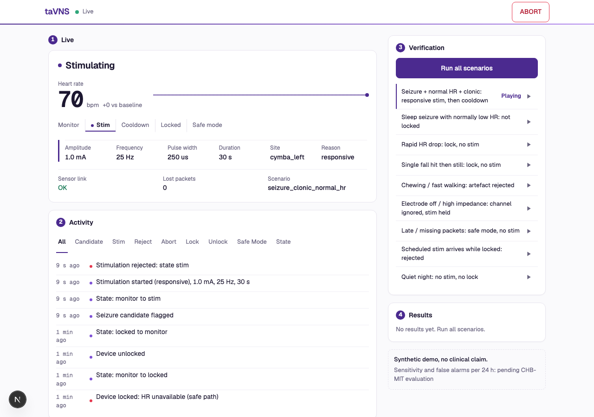

# TWS-taVNS


Software demo of a closed-loop earbud that detects a seizure and responds with vagus-nerve stimulation (taVNS),
with a safety layer that can always stop it.



## Run it
```bash
make setup      # once
make dev        # API :8000 + dashboard http://localhost:3000
make test       # 9 scenarios + unit tests
make demo S=rapid_hr_drop   # one scenario in the terminal (omit S for the default)
make mobile     # Expo app (optional)
```

## How it works
```
earbud (sim) --SensorPacket--> link --> signal --> safety --> StimCommand --> stimulator
                                         dsp,       gate, fsm,
                                         detect     limiter       Abort always wins
```
`tws/pipeline.py` is the only file that knows the whole chain. Each stage only imports stages to its left.

| Folder | Job |
|---|---|
| `tws/contract.py` | The two messages that cross the hardware boundary (JSON + CRC32) |
| `tws/link.py` | Transport interface + lossy simulated link |
| `tws/signal/` | Filters, features, artefact rules, HR from PPG; seizure detector |
| `tws/safety/` | `gate` (HR, fall, impedance locks), `fsm` (monitor/stim/cooldown/locked), `stim` (limiter + fake stimulator) |
| `tws/pipeline.py` | link -> signal -> safety -> stimulator, one `tick()` |
| `tws/sim/` | Fake earbud and the 9 test scenarios |
| `tws/api/` | FastAPI + WebSocket telemetry for the apps |
| `apps/web`, `apps/mobile` | Dashboard and phone app; read-only except ABORT |
| `tests/` | Runs every scenario and the safety rules |

Full run guide with screenshots: [run.md](run.md). Docs: [`docs/api.md`](docs/api.md) (API both apps use), [`docs/hardware.md`](docs/hardware.md) (how to swap in a real earbud).

## License
MIT, see [LICENSE](LICENSE).
