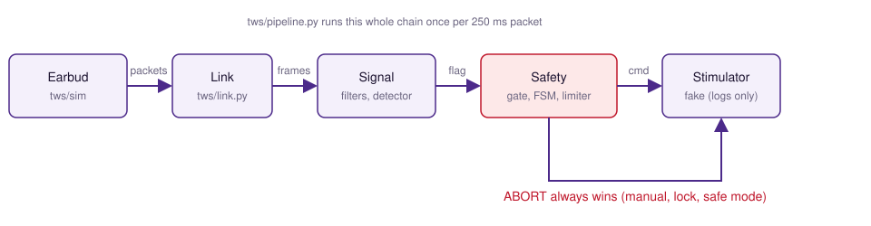
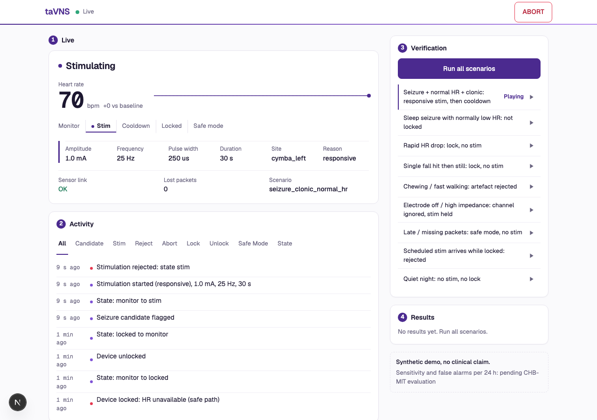
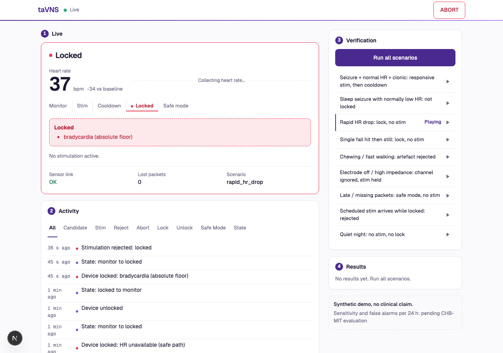
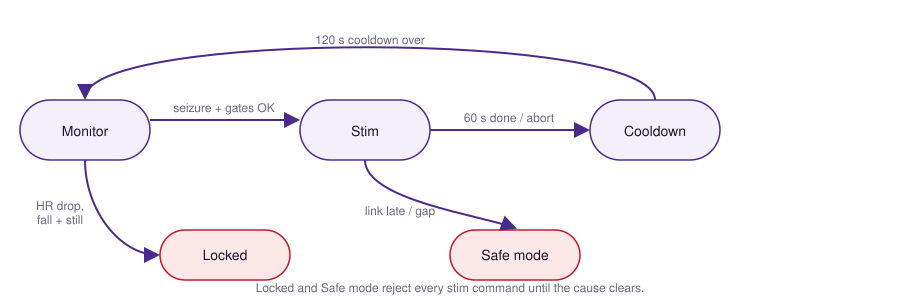

# How to run the demo

A simulated earbud streams EEG, heart rate and motion data. The software watches it, decides whether a seizure is happening, and either starts stimulation or refuses because a safety rule says no. Nothing here is real hardware.



## 1. Set up (once)

You need Python 3.11+ and Node 20+.

```bash
make setup
```

This creates `.venv`, installs the Python package, and runs `npm install` in `apps/web` and `apps/mobile`.

## 2. Pick what to run

| Command | What it does | Use it when |
|---|---|---|
| `make test` | Runs all 9 scenarios plus the unit tests. About 2 seconds. | You want a pass/fail answer |
| `make demo` | Plays one scenario in the terminal and prints its event log | You want to read what the device decided and why |
| `make demo S=rapid_hr_drop` | Same, for a scenario you choose (names in section 4) | |
| `make dev` | Starts the API on `:8000` and the web dashboard on `:3000` | You want to watch it live |
| `make api` / `make web` | Start only one half of `make dev` | You want separate terminals |
| `make mobile` | Starts the Expo phone app | You want to show it on a phone |

Stop anything with `Ctrl+C`.

### Terminal demo

```bash
make demo S=rapid_hr_drop
```

Output is a timeline, one line per decision, ending in `PASS` or `FAIL`:

```
   73.8s  lock       {'reasons': ['HR unavailable (safe path)']}
   73.8s  state      {'frm': 'monitor', 'to': 'locked'}
   85.0s  reject     {'why': 'locked', 'scheduled': False}
PASS
```

Here the heart rate collapsed from 70 to 35 bpm. While the 8 s pulse window still mixed both rates there was no clean reading, so the device locked on the safe path; from then on the reading sat below the 40 bpm floor, and the stimulation request that followed was refused. `PASS` means that matches what the scenario expects.

### Live dashboard

```bash
make dev
```

Open <http://localhost:3000>. The simulation starts on its own. Click any scenario in the right-hand list to replay it, or **Run all scenarios** to get a pass/fail table.

**A seizure is detected and the device responds** (`seizure_clonic_normal_hr`). The state moves Monitor → Stim → Cooldown, and the Activity feed shows "Seizure candidate flagged" then "Stimulation started (responsive)".



**A safety rule blocks it** (`rapid_hr_drop`). Heart rate falls to about 35 bpm, the card turns red and says why, and every stimulation request is rejected.



What each part of the page means:

| Area | Shows |
|---|---|
| Top bar: **Live** / **Device autonomous** | Whether the dashboard is connected. If it drops, the device keeps running safely by itself and the page sends no commands. |
| **ABORT** | Stops stimulation right now and requires a review before the next scenario. The only control besides replaying scenarios. |
| 1 Live | Current state, heart rate vs. baseline, sensor link, lost packets, any lock reasons |
| 2 Activity | Every decision, filterable by type (candidate, stim, reject, abort, lock, unlock, safe mode, state) |
| 3 Verification | The 9 scenarios. Click one to play it. |
| 4 Results | Pass/fail for all scenarios after **Run all scenarios** |

## 2.1 The five states



| State | Meaning |
|---|---|
| Monitor | Watching. No stimulation. |
| Stim | Stimulating (60 s for a seizure response) |
| Cooldown | Waiting 120 s after a stimulation before another is allowed (at most 6 per hour, 30 per day) |
| Locked | A safety rule fired (heart rate under 40 bpm or 30% under baseline; a fall then stillness, held 3 min; no heart-rate signal). Stimulation refused until it clears. |
| Safe mode | The link to the sensor is late or has gaps, so the device can't trust its data. Stimulation refused. |

The detector only proposes. The state machine decides, and Locked and Safe mode beat everything.

## 3. Run it on a phone (optional)

```bash
make mobile
```

Scan the QR code with Expo Go. The phone and your computer must be on the same Wi-Fi. Inside the app, set the API address to your computer's IP, for example `http://192.168.1.20:8000`. `localhost` on a phone means the phone itself. Start `make api` in another terminal first.

## 4. The 9 scenarios

Each is a few minutes of simulated time, played faster than real time (10x by default).

| Name | What happens | Expected result |
|---|---|---|
| `seizure_clonic_normal_hr` | Seizure with normal heart rate | One responsive stim, then cooldown |
| `sleep_seizure_low_hr` | Seizure during sleep, where a low heart rate is normal | Stims, and does not lock |
| `rapid_hr_drop` | Heart rate collapses during a seizure | Locks, no stim |
| `fall_then_still` | One fall impact, then no movement | Locks, no stim |
| `chewing_walking` | Chewing and fast walking look like seizure signals | Rejected as artefact, no stim |
| `electrode_off` | An electrode comes off (high impedance) | Channel ignored, stim held |
| `late_packets` | Packets arrive late or go missing | Safe mode, no stim |
| `schedule_while_locked` | A scheduled stimulation arrives while locked | Rejected |
| `clean` | Quiet night | No stim, no lock |

Most of these are about the device correctly doing nothing. Only two of the nine should stimulate.

## 5. If something goes wrong

| Symptom | Fix |
|---|---|
| `make: .venv/bin/python: No such file` | Run `make setup` first |
| Dashboard says **Device autonomous** | The API isn't running. Use `make dev`, or start `make api`. |
| Port 8000 or 3000 already in use | Stop the other process, or run `lsof -i :8000` to find it |
| Web dashboard can't reach a different API address | Start it with `NEXT_PUBLIC_API=http://host:8000 make web` |
| Clicking a scenario returns 409 | A manual ABORT is waiting for review. Clear it in the mobile app, or run `curl -X POST -H "X-TWS-Client: 1" localhost:8000/clear_review`. |

## 6. For developers

- Code map and architecture: [README.md](README.md)
- API both apps use (REST plus WebSocket): [docs/api.md](docs/api.md)
- Swapping in a real earbud: [docs/hardware.md](docs/hardware.md)
- Where every parameter comes from: [docs/research/tws-tavns-evidence.pdf](docs/research/tws-tavns-evidence.pdf) (LaTeX source alongside)
